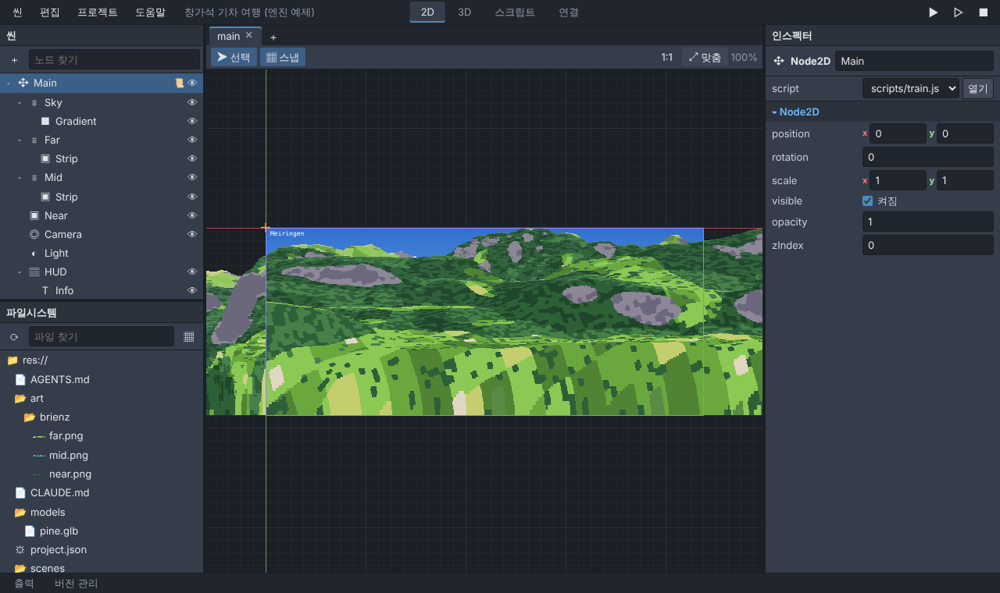
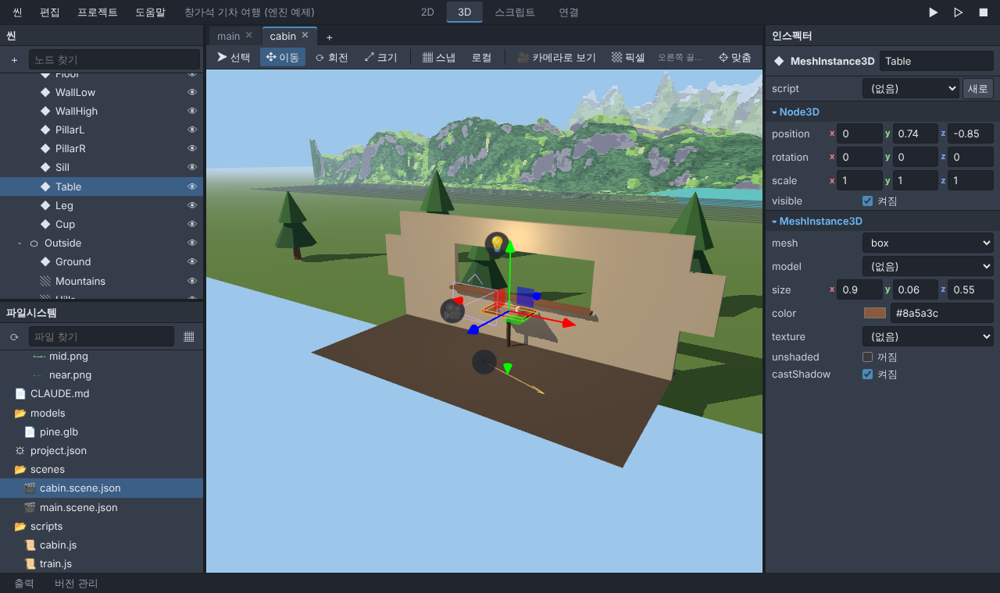
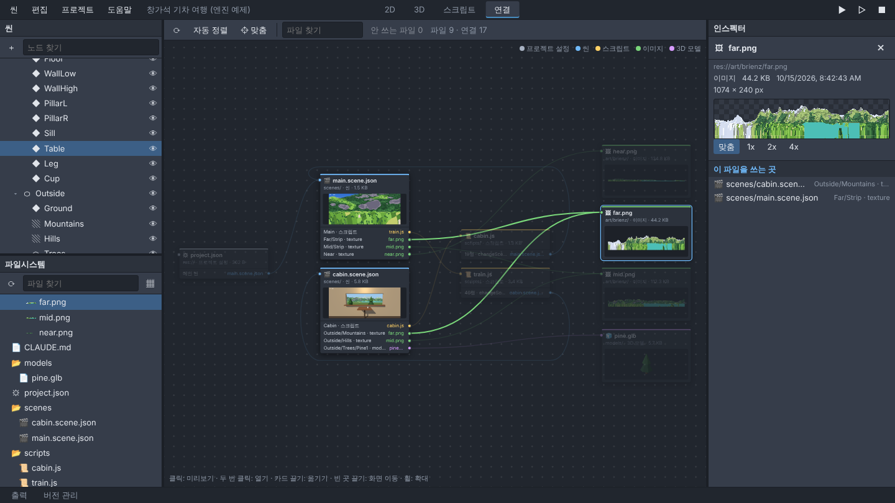

# Engine

픽셀 그래픽 게임을 만드는 작은 자체 엔진과, Godot처럼 생긴 에디터예요. 2D가 중심이고, 3D 노드도 있어서 3D 공간 위에 2D 화면(UI)을 얹을 수 있어요.
첫 목표는 「창가석 기차 여행」 같은 가벼운 게임(창밖 풍경이 겹겹이 흐르고, 시간대에 따라 빛이 바뀌는 게임)을 이 엔진으로 만드는 거예요.



| 3D 화면 | 「연결」 화면 (어떤 파일이 어디에 쓰이는지) |
| --- | --- |
|  |  |

## 실행하기

1. [Node.js](https://nodejs.org/) LTS 버전을 설치해요. (한 번만)
2. 이 저장소를 내려받은 폴더에서 터미널을 열고:
   ```
   npm install
   npm run editor
   ```
   윈도우라면 `start-editor.bat`을 두 번 눌러도 돼요. (처음 한 번은 `npm install`도 알아서 해요.)
3. 브라우저에서 http://127.0.0.1:8710/ 을 열면 에디터가 나와요.

처음에는 `examples/train-window` 예제(메이링겐 → 인터라켄 창밖 풍경)가 열려요.
내 게임 폴더를 열려면 `npm run editor -- --project D:\내게임` 처럼 폴더를 알려 주면 돼요. 빈 폴더여도 괜찮아요.

## 에디터에서 할 수 있는 것

| 자리 | 하는 일 |
| --- | --- |
| 위 메뉴 | 씬 새로 만들기/열기/저장, 실행 취소, 프로젝트 설정, 웹으로 내보내기 |
| ▶ ▷ ■ | 메인 씬 실행(F5), 지금 씬 실행(F6), 정지(F8). 게임은 새 창에서 돌아요 |
| 왼쪽 위 「씬」 | 노드 트리. 추가(Ctrl+A), 이름 바꾸기(F2), 끌어서 순서/부모 바꾸기, 숨기기 |
| 왼쪽 아래 「파일시스템」 | 프로젝트 파일. 누르면 인스펙터에 미리보기가 나와요. ▦ 버튼으로 그림(썸네일) 보기. 그림을 2D 화면으로 끌면 Sprite2D, 3D 화면으로 끌면 Sprite3D, .glb 모델을 3D 화면으로 끌면 MeshInstance3D가 생겨요 |
| 가운데 「2D」 | 화면 편집. 끌어서 옮기기, 가운데 버튼/Space+끌기로 화면 이동, 휠로 확대 |
| 가운데 「3D」 | 3D 편집. Q 고르기, W 이동, E 회전, R 크기 (화살표 손잡이를 끌기), 오른쪽 끌기로 둘러보기, 가운데 끌기로 화면 이동, 휠로 확대, F로 고른 노드 맞추기. 「카메라로 보기」는 게임 화면 그대로, 「픽셀」은 게임 해상도로 보여 줘요 |
| 가운데 「스크립트」 | 자바스크립트 편집기 (Ctrl+S 저장) |
| 가운데 「연결」 | 파일마다 카드 하나. 어느 씬의 어느 노드가, 어느 스크립트의 몇째 줄이 어떤 파일을 쓰는지 선으로 보여요. 안 쓰는 파일과 없는 파일(지워졌는데 아직 쓰는 곳이 있는 파일)도 표시해요 |
| 오른쪽 「인스펙터」 | 고른 노드의 속성 (숫자 이름을 좌우로 끌면 값이 바뀌어요). 파일을 고르면 그 파일의 미리보기: 그림 확대, 3D 모델 돌려 보기, 씬의 첫 장면, 소리 듣기, 스크립트 앞부분, 그리고 이 파일을 쓰는 곳 |
| 아래 「출력」 | 게임과 에디터의 메시지 |
| 아래 「버전 관리」 | Git: 바뀐 파일, 비교, 커밋, 받기(pull), 올리기(push) |

2D 노드: Node, Node2D, Sprite2D, ColorRect(그라데이션), Label, Parallax2D(시차 레이어), Camera2D, CanvasModulate(전체 색 곱하기 = 시간대 조명), CanvasLayer(화면에 고정된 UI).

3D 노드: Node3D, MeshInstance3D(상자·공·판·원기둥·원뿔, 또는 .glb/.gltf 모델), Sprite3D(그림 한 장을 3D 공간에 판으로), Camera3D, DirectionalLight3D(햇빛), OmniLight3D(전구), WorldEnvironment(배경색, 주변광, 안개).
3D는 2D 뒤에 그려지고, CanvasLayer UI는 맨 앞에 그려져요. 픽셀 그림은 3D에서도 뭉개지지 않게 그려요. 3D 노드가 없는 게임은 3D 코드를 아예 불러오지 않아서 가벼워요.
예제의 `scenes/cabin.scene.json`이 3D 객실이에요. 게임에서 Space를 누르면 2D 창밖 화면과 3D 객실을 오가요.

## AI (Claude Code, Codex)

AI는 에디터 안이 아니라 따로 여는 Claude Code나 Codex(터미널, 데스크톱 앱, VS Code 확장 등)에서 써요. 게임 폴더를 열고 일을 시키면 돼요.

1. 에디터에서 「프로젝트 → AI 안내 파일 만들기 (AGENTS.md)」를 한 번 눌러요. 게임 폴더에 엔진 사용 설명서 `AGENTS.md`(한 쪽 분량)와, 그 파일을 가리키는 `CLAUDE.md`가 생겨요. Claude Code와 Codex는 이 파일을 먼저 읽어요.
2. Claude Code나 Codex에서 게임 폴더를 열고 일을 시켜요. 예: "cabin 씬 창밖에 소나무를 세 그루 더 심어 줘".
3. 에디터 창으로 돌아오면 바뀐 씬과 스크립트를 알아서 다시 읽어요. (저장 안 한 수정이 있는 씬은 덮어쓰지 않고 출력 창에 알려 줘요.)

시키기 전에 「버전 관리」에서 커밋해 두면, 마음에 안 들 때 되돌리기 쉬워요. 무엇이 어디에 쓰이는지는 「연결」 화면에서 바로 확인할 수 있어요.

## 토큰을 아끼는 설계

- 게임 폴더의 `AGENTS.md`(엔진 요약표, 한 쪽 분량)를 AI가 먼저 읽어서, 파일을 뒤지며 엔진을 파악하느라 토큰을 쓰지 않아요. 엔진이 바뀌면 메뉴를 다시 눌러 최신으로 바꿔요.
- 씬 파일은 기본값과 다른 속성만 적고, 짧은 값은 한 줄에 써요. AI가 읽는 양이 적어요.
- 엔진 저장소 자체를 고칠 때는 저장소의 `AGENTS.md`(구조 지도)를 먼저 읽게 되어 있어서, 필요한 파일만 열어요. 파일도 기능별로 작게 나눠 두었어요.

## 웹과 스팀

- 게임은 자바스크립트(브라우저의 Canvas 2D, 3D는 WebGL과 three.js)로 돌아가요. 에디터의 「프로젝트 → 웹으로 내보내기」를 누르면 프로젝트 안 `export/web` 폴더에 웹사이트용 파일이 생겨요. itch.io 같은 곳에 그대로 올릴 수 있어요.
- 스팀용은 같은 웹 빌드를 Electron(또는 Tauri)으로 감싸서 윈도우/맥 실행 파일로 만들고, 업적 같은 스팀 기능은 steamworks.js로 붙이는 방식이 계획이에요. 아직 만들지 않았어요.

## 개발용 명령

```
npm run dev        # 에디터 코드를 고치면 바로 반영되는 개발 모드
npm run check      # 타입 검사 + 단위 테스트
npm run test:e2e   # 브라우저로 에디터를 직접 조작하는 테스트
npm run export:web -- <프로젝트 폴더>
```
